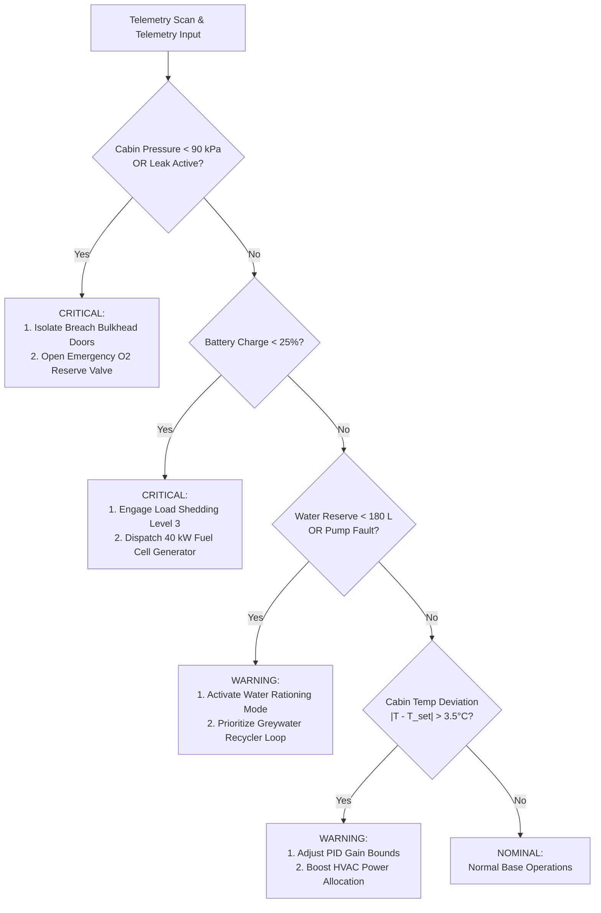

# LUNARIS: Mathematical Models & AI Algorithms Reference

This document provides formal mathematical derivations, control theory formulations, and machine learning models implemented across LUNARIS.

---

### 1. Physical Conservation Laws

#### 1.1 Power Balance Model
The state-of-charge of the 500 kWh lithium-sulfur battery bank is governed by:

$$P_{\text{next}} = \min\left(P_{\text{cap}}, \max\left(0, P_{\text{current}} + \left[P_{\text{gen}}(t) + P_{\text{backup}}(t) - P_{\text{cons}}(t)\right] \cdot \Delta t \cdot \eta_{\text{batt}}\right)\right)$$

Where:
- $P_{\text{cap}} = 500.0\text{ kWh}$
- $P_{\text{gen}}(t) = \frac{A_{\text{pv}} \cdot I_{\text{solar}}(t) \cdot \eta_{\text{pv}} \cdot (1 - \delta_{\text{dust}}) \cdot (1 - \phi_{\text{fault}})}{1000}$
  - $A_{\text{pv}} = 600\text{ m}^2$ (dual $300\text{ m}^2$ tracking solar arrays)
  - $I_{\text{solar}} \in [0, 1361]\text{ W/m}^2$
  - $\eta_{\text{pv}} = 0.32$ (space-grade triple-junction photovoltaic efficiency)
  - $\delta_{\text{dust}}$ is cumulative regolith deposition factor
  - $\phi_{\text{fault}}$ is fault attenuation (e.g. 0.70 during solar blackout)
- $P_{\text{backup}}(t) = 40.0\text{ kW}$ when auxiliary hydrogen fuel cell is dispatched.
- $P_{\text{cons}}(t) = P_{\text{avionics}} + P_{\text{oga}} + P_{\text{wrs}} + P_{\text{hvac}}(t) + P_{\text{science}}(L_{\text{shed}})$
  - $L_{\text{shed}} \in \{0, 1, 2, 3\}$ manages progressive electrical load shedding.

---

#### 1.2 Oxygen Mass Balance & Atmospheric Pressure
Oxygen reserve in cryogenic storage ($O_{\text{next}}$) is modeled as:

$$O_{\text{next}} = \max\left(0, \min\left(O_{\text{cap}}, O_{\text{current}} + \left[O_{\text{prod}} - O_{\text{cons}} - O_{\text{leaked}}\right] \cdot \Delta t + O_{\text{emergency}}\right)\right)$$

- $O_{\text{prod}} = 8.0\text{ kg/day}$ from the Oxygen Generation Assembly (OGA) electrolyzer.
- $O_{\text{cons}} = \sum_{i=1}^{N_{\text{crew}}} \dot{m}_{\text{resp}, i}$ ($\approx 0.84\text{ kg/person/day}$ scaled by activity).
- $O_{\text{leaked}} = \dot{m}_{\text{nominal}} + \dot{m}_{\text{puncture}}$
- Cabin pressure follows the ideal gas relation in volume $V_{\text{hab}} \approx 450\text{ m}^3$:
$$p_{\text{cabin}}(t) = p_0 - \int \kappa \cdot \dot{m}_{\text{leaked}}(t)\,dt$$

---

#### 1.3 Water Reclamation & Mass Balance
The closed-loop hydrological cycle follows:

$$W_{\text{next}} = \max\left(0, \min\left(W_{\text{cap}}, W_{\text{current}} + \left[W_{\text{recycled}} - W_{\text{used}} - W_{\text{lost}}\right] \cdot \Delta t\right)\right)$$

- $W_{\text{used}} = W_{\text{crew}} + W_{\text{electrolysis}}$
  - $W_{\text{crew}} \approx 12.0\text{ L/person/day}$ nominal ($7.8\text{ L}$ under water rationing mode).
  - $W_{\text{electrolysis}} = 1.125\text{ L H}_2\text{O}$ consumed per $1.0\text{ kg O}_2$ generated.
- $W_{\text{recycled}} = \dot{V}_{\text{wrs}} \cdot \eta_{\text{recovery}}$
  - $\eta_{\text{recovery}} = 0.90$ (nominal) vs $0.10$ during centrifuge pump degradation.
- $W_{\text{lost}} = 5.0\text{ L/day}$ (brine filter discard + evaporative loss).

---

#### 1.4 Resource Depletion & Burn Rate Formula
Remaining supply horizon for food, fuel cell reactants, medical consumables, and spare parts is computed via:

$$T_{\text{remaining}} = \frac{Q_{\text{available}}}{\dot{R}_{\text{burn}}}$$

Where:
- $Q_{\text{available}}$ is the current inventory stock.
- $\dot{R}_{\text{burn}} = \dot{R}_{\text{crew\_intake}} - \dot{R}_{\text{greenhouse\_yield}}$
  - $\dot{R}_{\text{greenhouse\_yield}} = +0.6\text{ kg/day}$ fresh biomass from hydroponics.

---

### 2. Control Theory: PID Thermal Regulation

Habitat internal temperature is governed by thermal mass dynamics:

$$C_{\text{th}} \frac{dT_{\text{in}}}{dt} = \dot{Q}_{\text{internal}} - U \cdot A \cdot \left(T_{\text{in}} - T_{\text{ext}}\right) + \dot{Q}_{\text{hvac}}$$

To maintain cabin comfort ($21.0^\circ\text{C}$), an active HVAC Proportional-Integral-Derivative (PID) controller computes the heating/cooling thermal demand:

$$u(t) = K_p \, e(t) + K_i \int_0^t e(\tau)\,d\tau + K_d \, \frac{de(t)}{dt}$$

Where:
- Error $e(t) = T_{\text{target}} - T_{\text{in}}(t)$
- $K_p = 3.0\text{ kW/}^\circ\text{C}$ (Proportional response)
- $K_i = 0.2\text{ kW}/(^\circ\text{C}\cdot\text{hr})$ with anti-windup clamp $[-50, +50]$
- $K_d = 1.5\text{ kW}\cdot\text{hr}/^\circ\text{C}$ (Derivative thermal inertia dampening)
- Output $u(t) > 0 \implies$ Electric resistive heating active.
- Output $u(t) < 0 \implies$ Fluid loop radiator heat rejection active.

---

### 3. Machine Learning Architectures

| Task | Model Architecture | Key Features | Target Metric |
| :--- | :--- | :--- | :--- |
| **Power Forecasting** | Gradient Boosting / Random Forest | Irradiance, External Temp, Crew Count, Shed Level, OGA, WRS | Power Demand (kW), 7-Day Battery SoC (%) |
| **Oxygen Trajectory** | Random Forest Regressor | Crew Count, Activity Profile, Leak Rate, OGA Output | Net Daily O2 Delta (kg/d), Days Remaining |
| **Water Shortage** | Ridge Linear Regression ($\alpha=1.0$) | Crew Count, Rationing Mode, WRS Efficiency, Pipe Leak | Net Daily Water Delta (L/d), 7-Day Water Level |
| **Anomaly Detection** | Isolation Forest ($c=0.04$) | Power, Battery %, O2 Level, Pressure, Water, Temp | Unsupervised Anomaly Index $[0.0, 1.0]$ |
| **Predictive Maintenance** | Random Forest Classifier | Health %, Operating Hours, Thermal Gradient, Load Factor | Failure Risk Probability $[0.0, 1.0]$, RUL (hours) |

---

### 4. Deterministic Autonomous Decision Trees

