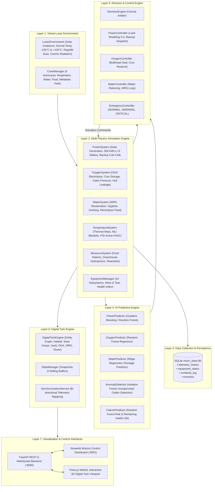

# LUNARIS: Complete System Architecture
## Virtual Moon Base Management System (AI + Digital Twin + 3D Simulation)

---

### 1. Architectural Philosophy

LUNARIS is designed as an autonomous, closed-loop mission control and digital twin simulation for a long-duration lunar surface outpost (e.g., Shackleton Crater rim, Lunar South Pole).

The architecture adheres to strict engineering principles:
1. **Separation of Concerns:** Distinct boundaries between physical simulation equations, autonomous decision engines, machine learning predictive models, persistent database storage, and 3D visualization.
2. **Deterministic Safety Primacy:** Emergency mitigation and life-support survival overrides are governed by deterministic, verifiable safety rules. AI assists with trend forecasting, anomaly detection, and predictive maintenance rather than overriding vital safety thresholds unconstrained.
3. **Continuous Digital Twin Synchronization:** All physical and simulated sensor readings update a unified in-memory graph of digital twin assets, which feeds both the Three.js WebGL spatial environment and the Mission Control Streamlit telemetry dashboard.

---

### 2. Seven-Layer System Architecture

---

### 3. Subsystem Interconnection & Flow

#### Power Balance Flow
Solar arrays convert incident solar irradiance into DC electrical power. If solar generation exceeds base electrical load, surplus energy charges the 500 kWh lithium-sulfur battery bank. When generation falls during lunar dusk or in shadowed craters, the battery discharges. If battery state-of-charge drops below 25%, the **PowerController** automatically commands **Level 3 Load Shedding** (disabling science labs, rovers, and auxiliary circuits) and starts the 40 kW Hydrogen-Oxygen Fuel Cell Generator.

#### Atmospheric & Life Support Loop
The **CrewManager** calculates metabolic consumption for the 4 astronauts ($3.36\text{ kg O}_2/\text{day}$, $48\text{ L H}_2\text{O}/\text{day}$, $6\text{ kg Food}/\text{day}$). The **Oxygen Generation Assembly (OGA)** uses water from the **Water Recovery System (WRS)** for electrolysis ($2\text{H}_2\text{O} \to 2\text{H}_2 + \text{O}_2$), generating breathable oxygen while the WRS recovers wastewater with 90% closed-loop efficiency.

#### Thermal Regulation Loop
A tuned PID controller computes thermal deviation $e(t) = T_{\text{target}} - T_{\text{internal}}(t)$ every step. If the cabin is too cold during lunar night ($-130^\circ\text{C}$ exterior), electric heating coils are throttled proportionally. If the cabin overheats during lunar noon ($+120^\circ\text{C}$ exterior), heat rejection radiator loops pump excess thermal mass to space.

